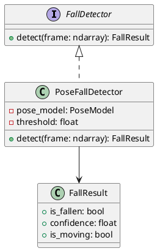

# CLAUDE.md

이 파일은 WatchOut 팀원들이 쓰는 Claude가 프로젝트 규칙을 지키도록 하기 위한 문서다.
프로젝트 소개(문제 정의, 유즈케이스, 설계)는 [README.md](README.md)를 본다.

## 프로젝트 요약
- **환자 곁을 지키는 반려 로봇카.** 평소에는 스마트워치 제스처로 로봇카와 놀고, 사용자가 쓰러지면 상태를 확인해 가족·119에 알린다. 핵심은 **"평소엔 친구, 위급할 땐 구조자"**이고, 워치와 카메라로 **두 번 확인해서 오알림을 줄이는 것**이다.
- 핵심 요구사항:
  - **제스처 조종**: 워치 제스처(가속도·자이로)로 로봇카를 부르고 움직인다.
  - **이중 확인 쓰러짐 감지**: 워치 충격 감지 → 로봇카가 다가감 → 카메라로 쓰러짐 확인. **둘 다 맞을 때만** 응급 상황으로 판단한다.
  - **괜찮아요 취소**: 충격 직후 워치가 진동으로 묻고, **10초 안에 취소하면** 알림을 보내지 않는다.
  - **응급 연락**: 가족에게 알림 + 상태 정보(사진, 움직임 여부)를 보내고, 119에 연락한다(시뮬레이션).
  - **로봇팔 도움**: 카메라로 물건을 찾아 로봇팔로 집어 가져다준다.
  - **영상 보호**: 카메라 영상은 로봇카 안에서만 분석한다. 응급 상황에서만 가족에게 사진을 보낸다.
- 하드웨어: 로봇카·로봇팔은 **이미 조립된 상태**다. 조립·부품 구매는 범위가 아니다.
- 범위 밖 (관련 기능을 제안하지 않는다):
  - **실제 119 자동 신고**: 데모에서는 화면·문자 시뮬레이션으로만 처리한다. 코드에서 실제 119로 전화·문자를 보내지 않는다.
  - **의료 진단**: 병명이나 원인을 판단하지 않는다. 쓰러짐 여부와 움직임 유무만 다룬다.
  - **여러 방·계단 이동**: 로봇카는 한 공간 안에서만 움직인다.

## 역할과 담당 영역
| 팀 | 담당 | 영역 |
|---|---|---|
| 🔧 HW — 로봇카 | 최소리 | 주행 제어, 사용자에게 다가가기, 장애물 정지, 카메라 영상 받기 |
| 🔧 HW — 로봇팔 | 조성완 | 로봇팔 집기·놓기, 위치 보정, 물건 위치 찾기 |
| 💻 SW | 구주영, 김은진 | 워치 앱·제스처·충격 감지, 쓰러짐 판단 AI, 워치↔차 통신, 서버·응급 알림, 보호자 앱 |

- HW와 SW는 **명령 메시지**(예: `{"cmd": "approach"}`, `{"cmd": "grab", "target": "phone"}`)로 만난다. 메시지 형식이 정해지면 이 문서에 기록하고, 모든 코드는 이 형식을 따른다.

## 기술 스택 (안)
- 워치: Wear OS, Kotlin / 제스처 인식 TensorFlow Lite
- 로봇카·로봇팔: 조립 완료된 로봇카·로봇팔 + 카메라, 제어 코드는 Python
- 비전 AI: MediaPipe Pose 또는 YOLO-Pose (쓰러짐 판단), OpenCV
- 통신: 워치 ↔ 로봇카 BLE 또는 Wi-Fi(MQTT)
- 서버: Firebase (Authentication, Firestore, Cloud Messaging 알림)

## 개발 환경
| 항목 | 버전 |
|---|---|
| Android Studio | (예: Ladybug 2024.2) |
| Kotlin | (예: 2.0) |
| Python | (예: 3.11) |
| TensorFlow | (예: 2.16) |
| OpenCV / MediaPipe | (예: 4.10 / 0.10) |

- Python 버전은 `.python-version` 파일이 기준이다 (CI도 이 파일을 읽는다).
- Python 의존성은 `requirements.txt`(실행용)와 `requirements-dev.txt`(lint·테스트 도구)에 **버전을 고정**해서 관리한다. 패키지를 추가하면 해당 파일도 함께 수정한다.

## 데이터 규칙
- **워치 센서**: 6축 데이터, 가속도(ax, ay, az) + 자이로(gx, gy, gz)
- **카메라**: 로봇카 카메라 영상·사진
- 저장 형식, 컬럼 순서, 샘플링 주기, 파일 이름 규칙, 충격 감지·쓰러짐 판단 기준값은 팀에서 정한 뒤 이 섹션에 기록하고, 모든 코드는 이 값을 따른다.
- 원본 데이터(`data/`), 영상·사진, 대용량 모델 파일은 **Git에 커밋하지 않는다**. 공유 드라이브에 두고, 리포에는 위치와 형식 설명만 남긴다.

## 보안·개인정보
- `google-services.json`, `.env`, API 키, 키스토어 파일은 **절대 커밋하지 않는다**. `.gitignore`에 포함되어 있는지 확인한다.
- 코드에 키나 비밀번호를 직접 적지 않는다.
- 카메라 영상과 움직임 데이터는 민감 정보다(얼굴, 집 안 모습, 건강 상태). **영상과 센서 원본 데이터를 서버나 로그로 보내지 않는다.** 영상은 로봇카 안에서만 분석한다.
- 응급 상황이 확정됐을 때만 가족에게 사진과 상태 정보를 보낸다.
- 보호자 연락처는 Firestore `users/{uid}/guardians`에 저장한다. 서버 저장 암호화(Firestore 기본)와 HTTPS 전송을 쓰고, 보안 규칙(`firebase/firestore.rules`)으로 **본인만** 읽고 쓰게 한다.
  - 폰 안의 키(Android Keystore)로 한 번 더 암호화하지 않는다. 그러면 응급 알림을 보내는 서버(#50)가 번호를 읽을 수 없기 때문이다.
  - 연락처를 로그에 출력하지 않는다.
- 로그인 토큰은 Firebase SDK가 앱 전용 저장소에 보관한다. 코드에서 토큰을 직접 저장하지 않고, 앱 백업·기기 이전에서 빠지게 한다(`allowBackup="false"`, `data_extraction_rules.xml`).

## 하드웨어·응급 기능 구현 주의
- **119는 실제로 연락하지 않는다.** 테스트와 데모에서는 시뮬레이션(화면 표시, 팀원 번호로 문자 등)만 쓴다.
- 로봇카·로봇팔 코드는 **멈춤 명령을 항상 가장 먼저** 처리하고, 통신이 끊기면 스스로 멈추게 한다.
- 모터·로봇팔 제어 로직(속도 제한, 각도 범위 등)은 실제 기기 없이도 테스트할 수 있게 하드웨어 접근 부분과 분리해서 작성한다.

## 설계 문서화 (UML)
구현한 구조는 **PlantUML**로 `docs/uml/`에 정리한다. 코드와 설계 그림이 항상 같이 움직이도록 한다.

- **언제:** 클래스·모듈을 새로 만들거나, 클래스/메서드/관계를 바꾸면 **같은 PR 안에서** 다이어그램을 작성·갱신한다.
- **위치·이름:** `docs/uml/<모듈명>.puml` (영문 소문자 + 하이픈)
  - 예) `docs/uml/gesture-recognizer.puml`, `docs/uml/fall-detector.puml`, `docs/uml/car-controller.puml`
- **종류:**
  - 클래스 구조 → 클래스 다이어그램
  - 처리 흐름(충격 감지 → 괜찮으세요? → 로봇카 이동 → 카메라 확인 → 응급 알림) → 시퀀스 또는 액티비티 다이어그램
- **표기법:**
  - 파일은 `@startuml` / `@enduml`로 감싼다.
  - 접근 제어자: `+` public, `-` private, `#` protected
  - 추상: `abstract class`, 추상 메서드는 `{abstract}`
  - 관계: `<|--` 상속, `<|..` 인터페이스 구현, `*--` 합성, `o--` 집합, `-->` 의존
  - 속성·메서드에 타입을 적는다. 예) `- windowSize: Int`, `+ predict(window: FloatArray): GestureResult`
- **기준:** 코드와 다이어그램이 다르면 **코드가 기준**이다. 다이어그램을 코드에 맞춰 고친다.
- **보기:** GitHub는 PlantUML을 그림으로 보여주지 않는다. VS Code의 PlantUML 확장으로 미리 보고, README나 발표에 쓸 그림은 PNG/SVG로 내보내 `docs/uml/img/`에 둔다.



## 테스트와 정적 분석 (CI)
PR을 올리거나 `main`/`dev`에 push하면 GitHub Actions(`.github/workflows/ci.yml`)가 자동으로 검사한다.
**CI가 실패(❌)한 PR은 merge하지 않는다.**

### Python
| 검사 | 도구 | 로컬에서 실행 |
|---|---|---|
| Lint (버그 가능성, import 정렬 등) | ruff | `ruff check .` (자동 수정: `ruff check --fix .`) |
| 포맷 | ruff format | `ruff format .` |
| 단위 테스트 | pytest | `pytest` |

- 설정은 `pyproject.toml`에 있다. 규칙을 바꾸려면 팀과 합의 후 이 파일을 수정한다.
- 처음 한 번 도구 설치: `pip install -r requirements-dev.txt`
- **PR을 올리기 전에** 위 세 명령을 로컬에서 실행해 통과시킨다.

### 테스트 작성 규칙
- 함수·클래스를 만들면 **같은 PR에서** 테스트를 함께 작성한다.
- 테스트 파일은 코드 옆의 `tests/` 폴더에 `test_<모듈명>.py`로 만들고, 함수 이름은 `test_`로 시작한다.
  - 예) `vision/fall_detector.py` → `vision/tests/test_fall_detector.py`
- 특히 다음 로직은 반드시 테스트한다: 충격 감지 기준 판단, 10초 취소 판정, 이중 확인(워치 + 카메라) 판단, 명령 메시지 만들기·해석, 멈춤 명령 우선 처리.
- 테스트에 센서 원본 데이터나 실제 영상·사진 파일을 쓰지 않는다. 센서 값, 자세 좌표 같은 작은 가짜 데이터를 코드 안에서 만들어 쓴다.

### Kotlin (앱)
- Android 프로젝트가 생성되면 ktlint / Android Lint와 JUnit 테스트를 CI에 추가한다 (#30).

## 브랜치 전략
```
main        ← 항상 실행 가능한 안정 버전 (직접 push 금지, PR로만 merge)
 └─ dev     ← 개발 통합 브랜치
     ├─ feature/#이슈번호-기능명   예) feature/#12-gesture-register
     ├─ fix/#이슈번호-버그명       예) fix/#20-volume-crash
     └─ docs/#이슈번호-문서명      예) docs/#3-readme
```
- 모든 작업은 **이슈를 먼저 만들고** 그 번호로 브랜치를 만든다.
- 기능 브랜치는 `dev`에서 만들고, PR도 `dev`로 보낸다.
- `main`과 `dev`에 직접 커밋하거나 push하지 않는다.

## 작업 순서
```bash
git switch dev
git pull origin dev
git switch -c feature/#12-gesture-register
# ... 작업 ...
git add .
git commit -m "feat: 제스처 등록 화면 추가 (#12)"
git push -u origin feature/#12-gesture-register
# GitHub에서 dev로 Pull Request 생성 → 리뷰 → merge
```

## 커밋 메시지
형식: `타입: 내용 (#이슈번호)` — 내용은 한국어로 쓴다.

| 타입 | 의미 |
|---|---|
| `feat` | 새 기능 |
| `fix` | 버그 수정 |
| `docs` | 문서 수정 |
| `refactor` | 동작 변경 없는 코드 정리 |
| `model` | AI 모델·학습 코드 |
| `chore` | 설정, 빌드, 기타 |

- 커밋은 작게, 자주 한다. 서로 관계없는 변경을 한 커밋에 섞지 않는다.

## Pull Request
- 제목: `[타입] 내용` 예) `[feat] 제스처 등록 화면`
- 본문에 무엇을 왜 바꿨는지 쓰고, `Closes #이슈번호`를 넣는다.
- 구조를 바꾼 PR은 본문에 갱신한 다이어그램 파일(`docs/uml/...puml`)을 적는다.
- **merge는 PM(리포 관리자)만 한다.** PM이 PR 내용을 확인하고 merge하는 것이 최종 승인이다. 팀원끼리 서로 PR을 읽고 Approve·댓글을 남기는 것은 권장한다.
- merge한 브랜치는 삭제한다 (merge 직후 **Delete branch** 버튼).
- `main`과 `dev`는 GitHub 브랜치 보호로 다음이 강제된다: PR로만 merge, CI(`Python lint & test`) 통과 필수, PM만 merge 가능, 강제 덮어쓰기(force push)·삭제 금지. 관리자도 예외 없이 적용된다.
- Android CI(`Android test & lint`)는 Android 코드가 `dev`에 처음 merge될 때 필수 조건에 추가한다 (#30). 그 전에 추가하면 검사가 실행되지 않아 모든 PR의 merge가 막힌다.
- 아직 merge할 단계가 아닌 프로토타입 PR은 **Draft**로 올린다.

## Claude 작업 규칙
- 답변과 설명은 한국어로 한다.
- 작성하거나 수정한 코드는 무엇을 왜 그렇게 했는지 자세히 설명한다.
- 클래스·모듈을 구현하거나 구조를 바꾸면, "설계 문서화 (UML)" 규칙에 따라 해당 `.puml` 파일도 함께 작성·수정하고 다이어그램 내용을 설명한다.
- 코드를 작성하면 테스트도 함께 작성하고, 작업을 마치기 전에 `ruff check .`, `ruff format --check .`, `pytest`를 실행해 결과를 사용자에게 알린다.
- 작업 전에 지금 브랜치가 `main`/`dev`가 아닌 작업 브랜치인지 확인한다. 아니면 위 규칙대로 브랜치를 만들자고 제안한다.
- 커밋과 push는 사용자가 요청할 때만 하며, 위 커밋 메시지 규칙을 따른다.
- 다른 팀원 담당 영역의 파일을 크게 고쳐야 하면, 먼저 사용자에게 알리고 이슈/Discord로 공유하도록 권한다.
- merge 충돌이 나면 상대방 코드를 임의로 지우지 말고, 양쪽 변경 내용을 설명한 뒤 사용자와 함께 해결한다.
- 센서 데이터 형식, 신뢰도 기준값처럼 팀이 정한 값이 이 문서에 있으면 그대로 따르고, 바꿔야 하면 이 문서도 함께 수정하자고 제안한다.
