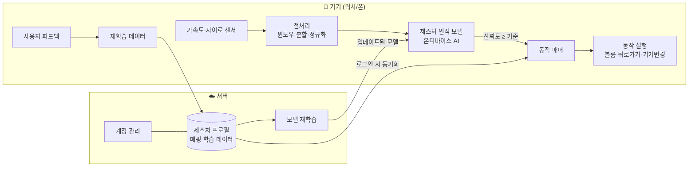

# ⌚ WatchOut — 나만의 제스처로 기기를 제어하는 앱

> 가속도·자이로 센서와 AI로 **내가 정한 제스처**를 인식하고, **내가 원하는 동작**을 실행하는 개인 맞춤형 제스처 컨트롤 앱

## 👥 팀원 및 역할
| 이름 | GitHub | 역할 | 담당 |
|---|---|---|---|
| (이름) | @아이디 | 팀장 / PM | 일정·이슈 관리, 기획, 발표 |
| (이름) | @아이디 | AI | 센서 데이터 수집·전처리, 제스처 인식 모델 학습 |
| (이름) | @아이디 | 앱 | 워치/폰 앱 개발, 제스처→동작 실행 연동 |
| (이름) | @아이디 | 서버 | 계정, 제스처 프로필 저장·동기화 |

## ❓ 문제 정의
스마트워치의 제스처 기능(손목 돌리기로 통화 거절, 노크로 손전등 켜기 등)은 화면을 보지 않고 기기를 다룰 수 있어 편리하지만, 다음과 같은 문제가 있다.

1. **오인식**: 의도하지 않은 순간에 손전등이 켜지거나 전화가 받아지는 등 오작동이 잦다.
2. **커스터마이징 불가**: 제조사가 정해 둔 제스처만 쓸 수 있어서, 내가 편한 동작이나 원하는 기능으로 바꿀 수 없다.
3. **기기 종속**: 제스처 설정이 특정 기기에 묶여 있어서, 기기를 바꾸거나 여러 기기를 쓰면 다시 설정해야 한다.

### 목표
- 사용자가 **직접 제스처를 등록**하고 **원하는 동작에 연결**한다.
- 가속도·자이로 센서 데이터를 **AI로 분석**해 제스처를 인식한다.
- 사용자 피드백으로 **계속 재학습**해서 정확도를 높이고 오작동을 줄인다.
- 제스처 설정을 **계정에 저장**해서 어떤 기기에서도 그대로 쓴다.

## 🎬 유즈케이스 시나리오
| # | 시나리오 | 흐름 | 결과 |
|---|---|---|---|
| UC1 | 나만의 제스처 등록 | 원하는 동작을 여러 번 반복 → 센서 데이터 수집·학습 → 이름 지정 후 저장 | 내 몸에 맞는 제스처 등록 |
| UC2 | 제스처에 동작 연결 | 제스처 선택 → 실행할 동작 선택(볼륨, 뒤로 가기, 음악 재생, 기기 변경 등) | "손목 두 번 흔들기 → 볼륨 올리기" 매핑 |
| UC3 | 제스처로 기기 제어 | 제스처 수행 → 실시간 인식 → 신뢰도 기준 이상이면 동작 실행 + 진동 알림 | 화면을 보지 않고 기기 제어 |
| UC4 | 오인식 피드백과 재학습 | "잘못 인식됨" / "이건 OO 제스처였음" 피드백 → 모델 재학습 | 쓸수록 정확해지고 오작동 감소 |
| UC5 | 다른 기기에서 사용 | 새 기기에서 로그인 → 제스처·매핑·모델 동기화 | 재설정 없이 바로 사용 |

## 🏗️ High Level Design

## 🛠️ 기술 스택 (안)
- **앱:** Android / Wear OS (Kotlin)
- **AI:** Python, TensorFlow → TensorFlow Lite(온디바이스 추론)
- **서버/DB:** Firebase (Authentication, Firestore, Storage)

## 📅 마일스톤
- [ ] **M1** 기획 및 설계: 문제 정의, 유즈케이스, 시스템 설계
- [ ] **M2** 데이터 및 모델: 센서 데이터 수집 앱, 기본 제스처 인식 모델
- [ ] **M3** 앱 핵심 기능: 제스처 등록, 동작 매핑, 동작 실행
- [ ] **M4** 개인화 및 동기화: 피드백 재학습, 계정별 저장·동기화
- [ ] **M5** 테스트 및 발표: 오인식률 측정, 데모, 발표 자료

## 🤝 협업
개발 환경, 브랜치·커밋·PR 규칙은 [CLAUDE.md](CLAUDE.md)를 참고한다.
