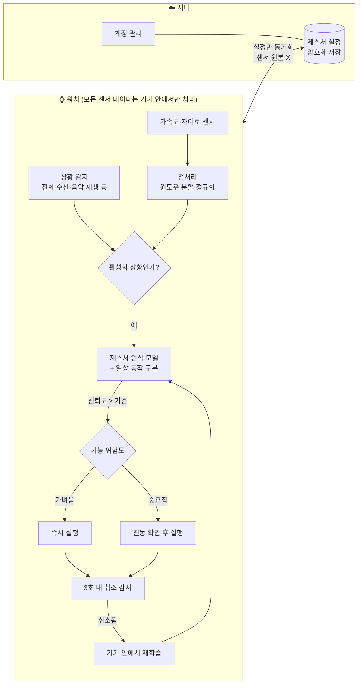

# ⌚ WatchOut — 오작동 없는 나만의 제스처

> 사용자가 직접 만든 제스처도 **일상 동작과 헷갈리지 않고** 정확하게 동작하도록 하는, 가속도·자이로 센서 기반 개인 맞춤형 제스처 컨트롤 앱

## 👥 팀원 및 역할
| 이름 | GitHub | 역할 | 담당 |
|---|---|---|---|
| (이름) | @아이디 | 팀장 / PM | 일정·이슈 관리, 기획, 발표 |
| (이름) | @아이디 | AI | 센서 데이터 수집·전처리, 제스처 인식·오인식 방지 모델 |
| (이름) | @아이디 | 앱 | 워치 앱 개발, 상황별 활성화·위험도별 실행 |
| (이름) | @아이디 | 서버·보안 | 계정, 제스처 설정 암호화 저장 |

## ❓ 문제 정의
### 배경
스마트워치는 손목 돌리기, 손가락 맞대기 같은 제스처로 화면을 보지 않고 기기를 다룰 수 있게 해 준다.
하지만 제조사는 미리 정해 둔 몇 개의 제스처만 제공한다. 이는 기술이 부족해서가 아니다.
사용자가 직접 만든 제스처는 일상 동작과 헷갈리기 쉽고, 그 오작동을 제조사가 미리 검증할 수 없기 때문이다.

### 문제
1. **커스텀 제스처의 오인식**: 사용자가 몇 번 보여준 동작만으로는 "이 동작이 아닌 것"을 배울 수 없다. 그래서 걷기, 설거지 같은 일상 동작에도 반응한다.
2. **좋은 제스처를 고르기 어려움**: 사용자는 자기가 고른 동작이 일상 동작과 얼마나 비슷한지 알 수 없다.
3. **오작동 피해가 기능마다 다름**: 손전등이 잘못 켜지는 것과 전화가 잘못 받아지는 것은 위험도가 다른데, 지금은 똑같이 취급한다.

> 💡 핵심: "제스처를 마음대로 만들 수 있게 하자"가 아니라 **"사용자가 만든 제스처도 오작동하지 않게 하자"**.

### 목표
| 목표 | 내용 |
|---|---|
| **등록 단계 품질 검사** | 제스처를 등록할 때 사용자의 평소 움직임과 비교해서, "이 동작은 걸을 때와 비슷해서 오작동할 수 있어요"처럼 미리 알려 준다. |
| **상황별 활성화** | 제스처가 필요한 순간에만 켠다. 예) 전화가 올 때만 '거절 제스처'를 받는다. |
| **위험도별 처리** | 손전등·음악 같은 가벼운 기능은 바로 실행하고, 전화·메시지 같은 중요한 기능은 진동으로 한 번 확인한 뒤 실행한다. |
| **자연스러운 피드백 학습** | 실행 직후 3초 안에 사용자가 취소하면 "잘못 인식했다"고 보고 자동으로 학습한다. 따로 묻지 않는다. |
| **기기 안에서 학습** | 센서 원본 데이터는 서버로 보내지 않고 워치 안에서 학습한다. 계정에는 제스처 설정만 암호화해서 저장한다. |

### 성공 기준 (예시)
- 하루 착용 중 오작동 횟수를 기본 제스처보다 낮춘다. (예: 하루 1회 미만)
- 제스처 등록에 필요한 시연 횟수를 5회 이하로 한다.

### 범위에서 뺀 것
- **"어떤 기기에서도 그대로 사용"**: 워치·반지·폰은 센서 위치와 측정 속도가 달라 같은 동작도 데이터가 다르게 나온다. 기술적으로 어렵고 핵심도 흐려지므로 제외한다. 이후 "같은 종류의 기기끼리 설정 옮기기"로 확장을 검토한다.

## 🎬 유즈케이스 시나리오
| # | 시나리오 | 흐름 | 결과 |
|---|---|---|---|
| UC1 | 제스처 등록 + 품질 검사 | 원하는 동작을 5회 이하 반복 → 평소 움직임 데이터와 비교 → 비슷하면 경고하고 다른 동작 추천 | 오작동 가능성이 낮은 제스처 등록 |
| UC2 | 동작 연결 + 활성화 상황 설정 | 제스처 선택 → 실행할 기능 선택 → 언제 켤지 설정 (예: 전화 수신 중, 음악 재생 중) | "전화 올 때 손목 털기 → 거절" 매핑 |
| UC3 | 가벼운 기능 실행 | 음악 재생 중 제스처 → 인식 → 바로 다음 곡 재생 | 화면을 보지 않고 즉시 제어 |
| UC4 | 중요한 기능 실행 | 전화 수신 중 제스처 → 인식 → 진동으로 확인 요청 → 사용자가 확인하면 실행 | 중요한 기능의 오작동 사고 방지 |
| UC5 | 자연스러운 피드백 학습 | 잘못 실행됨 → 사용자가 3초 안에 취소 → 워치 안에서 자동 재학습 | 묻지 않아도 쓸수록 정확해짐 |

## 🏗️ High Level Design

## 🛠️ 기술 스택 (안)
- **앱:** Wear OS (Kotlin)
- **AI:** Python, TensorFlow → TensorFlow Lite (온디바이스 추론·학습)
- **서버/DB:** Firebase (Authentication, Firestore — 제스처 설정 암호화 저장)

## 📅 마일스톤
- [ ] **M1** 기획 및 설계: 문제 정의, 유즈케이스, 시스템 설계
- [ ] **M2** 데이터 및 모델: 센서 수집 앱, 제스처·일상 동작 데이터 수집, 기본 인식 모델
- [ ] **M3** 앱 핵심 기능: 등록 품질 검사, 동작 매핑, 상황별 활성화, 위험도별 실행
- [ ] **M4** 개인화 및 보안: 취소 기반 자동 학습(기기 안), 제스처 설정 암호화 저장
- [ ] **M5** 테스트 및 발표: 하루 오작동 횟수 측정, 데모, 발표 자료

## 🤝 협업
개발 환경, 브랜치·커밋·PR 규칙은 [CLAUDE.md](CLAUDE.md)를 참고한다.
