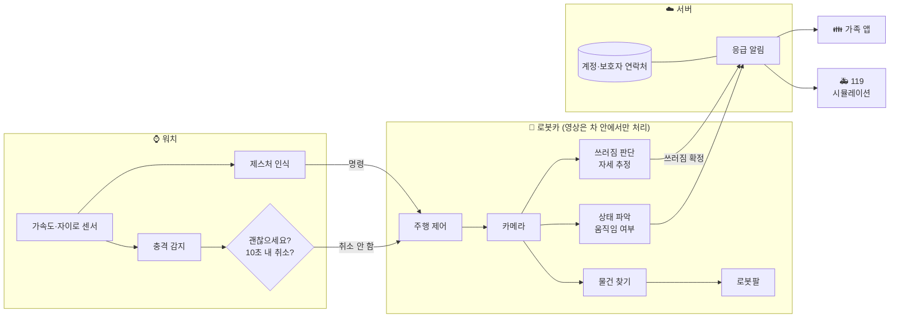

# ⌚🚗 WatchOut — 환자 곁을 지키는 반려 로봇카

> 평소에는 **스마트워치 제스처로 함께 노는 반려 로봇카**, 사용자가 쓰러지면 **상태를 확인하고 가족·119에 알리는 응급 지킴이**

## 👥 팀원 및 역할
| 이름 | 팀 | 담당 |
|---|---|---|
| 최소리 | 🔧 HW — 로봇카 | 주행 제어, 사용자에게 다가가기, 카메라 영상 |
| 조성완 | 🔧 HW — 로봇팔 | 로봇팔 동작, 물건 찾기 |
| 구주영 | 💻 SW | 워치 앱·제스처, 쓰러짐 판단 AI, 서버·응급 알림 |
| 김은진 | 💻 SW | 워치 앱·제스처, 쓰러짐 판단 AI, 서버·응급 알림 |

### 역할 상세
- **🔧 하드웨어팀**: 로봇카와 로봇팔이 **실제로 움직이게** 만든다. (차에 올라가는 코드)
- **💻 소프트웨어팀**: 워치·서버·AI처럼 **판단하고 알리는** 부분을 만든다. 두 명이 함께 맡고, 세부 분담은 팀 안에서 정한다.

| | 🔧 로봇카 (최소리) | 🔧 로봇팔 (조성완) | 💻 소프트웨어 (구주영, 김은진) |
|---|---|---|---|
| **전담** | 주행 모터 제어 (전진·회전·정지) | 로봇팔 집기·놓기 동작 | ⌚ 워치: Wear OS 앱, 제스처 인식 모델, 충격 감지, "괜찮으세요?" 진동·취소 |
| | 사용자 쪽으로 다가가기·따라가기 | 집는 위치 보정 | 🧠 AI: 카메라 영상으로 쓰러짐 판단(자세 추정), 상태 파악(움직임 여부) |
| | 장애물 앞에서 멈추기 | 카메라로 물건 위치 찾기 | 📡 통신·서버: 워치↔차 통신(BLE/MQTT), Firebase 계정, 가족 알림·119 시뮬레이션 |
| | 카메라 장착·영상 받기 | 데모 무대 준비 | 👪 보호자 앱 (간단한 웹) |
| **공동** | 데모 영상 촬영 | 일정·이슈 관리 | 발표 자료, 테스트·성공 기준 측정 |
| **관련 UC** | UC1, UC2 | UC5 | UC1~UC4 |

> 🔗 **HW ↔ SW 약속**: 두 팀이 만나는 지점은 "명령 메시지"(예: `{"cmd": "approach"}`, `{"cmd": "grab", "target": "phone"}`)와 "카메라 영상"이다. **M2 전에 이 형식을 먼저 정하면** 두 팀이 따로 개발할 수 있다.

## ❓ 문제 정의
### 배경
혼자 지내는 고령자나 만성질환자는 쓰러져도 도와줄 사람이 곁에 없는 경우가 많다.
쓰러진 뒤 발견이 늦어지면 치료할 수 있는 골든타임을 놓친다.

### 문제
1. **스스로 신고할 수 없음**: 의식을 잃거나 움직이기 힘들면 휴대폰까지 갈 수 없다.
2. **잦은 오알림**: 워치 충격 센서만으로는 손을 세게 내려놓은 것과 쓰러진 것을 잘 구분하지 못한다. 오알림이 많으면 가족이 알림을 무시하게 된다.
3. **알림만으로는 상황을 모름**: 가족은 "쓰러짐 감지" 알림만 받아서는 지금 얼마나 위급한지 알 수 없다.
4. **평소에 안 쓰면 방치됨**: 응급용 기기는 평소에 쓸 일이 없어서 충전하지 않거나 차고 다니지 않게 된다.

> 💡 핵심: **평소엔 친구, 위급할 땐 구조자.** 매일 함께 놀아서 늘 곁에 있게 하고, 위급할 때는 **워치(충격) + 카메라(눈으로 확인)** 두 번 확인해서 오알림을 줄인다.

### 목표
| 목표 | 내용 |
|---|---|
| **제스처 놀이** | 워치를 흔들거나 돌리는 제스처로 로봇카를 부르고 움직인다. 매일 쓰는 재미를 준다. |
| **이중 확인 쓰러짐 감지** | 워치가 충격을 감지하면 로봇카가 다가가 카메라로 확인한다. 둘 다 "쓰러짐"일 때만 응급 상황으로 판단한다. |
| **괜찮아요 취소** | 충격 직후 워치가 진동으로 "괜찮으세요?"를 묻고, 10초 안에 취소하면 알림을 보내지 않는다. |
| **응급 연락** | 가족에게 알림과 상태 정보(사진, 움직임 여부)를 보내고, 119에 연락한다. |
| **로봇팔 도움** | 약이나 휴대폰 같은 물건을 집어 사용자에게 가져다준다. |
| **영상 보호** | 카메라 영상은 로봇카 안에서만 분석하고, 응급 상황에서만 가족에게 사진을 보낸다. |

### 성공 기준 (예시)
- 쓰러짐 시연 10회 중 9회 이상 감지, 일상 동작(앉기, 손 내려놓기) 오알림 1회 이하
- 충격 감지부터 가족 알림까지 1분 이내
- 로봇팔로 정해진 물건 집기 성공률 70% 이상

### 범위에서 뺀 것
- **실제 119 자동 신고**: 실제 신고는 법적·기술적 문제가 있어서, 데모에서는 "119 신고 화면/문자 시뮬레이션"으로 대신한다.
- **의료 진단**: 병명이나 원인을 판단하지 않는다. 쓰러짐 여부와 움직임 유무만 전달한다.
- **여러 방·계단 이동**: 로봇카는 한 공간(방 하나) 안에서만 움직인다.

## 🎬 유즈케이스 시나리오
| # | 시나리오 | 흐름 | 결과 |
|---|---|---|---|
| UC1 | 제스처로 놀기 | 손목 흔들기 → 워치가 제스처 인식 → 로봇카가 다가옴 / 회전 / 따라오기 | 화면 없이 로봇카와 상호작용 |
| UC2 | 쓰러짐 감지 | 워치 충격 감지 → 로봇카가 사용자 쪽으로 이동 → 카메라로 쓰러짐 확인 | 두 번 확인해서 정확하게 판단 |
| UC3 | 오알림 취소 | 충격 감지 → 워치 진동 "괜찮으세요?" → 10초 안에 취소 | 가족에게 불필요한 알림 안 감 |
| UC4 | 응급 연락 + 상태 전달 | 쓰러짐 확정 → 가족 앱에 알림·사진·움직임 여부 전송 → 119 연락(시뮬레이션) | 가족이 상황을 바로 파악 |
| UC5 | 로봇팔로 물건 전달 | 제스처나 앱으로 요청 → 카메라로 물건 찾기 → 로봇팔로 집어서 가져옴 | 움직이기 힘들 때 도움 |

## 🏗️ High Level Design

## 🛠️ 기술 스택 (안)
- **워치:** Wear OS (Kotlin), 제스처 인식 TensorFlow Lite
- **로봇카·로봇팔:** 조립 완료된 로봇카·로봇팔 + 카메라, 제어 코드는 Python
- **비전 AI:** MediaPipe Pose 또는 YOLO-Pose (쓰러짐 판단), OpenCV
- **통신:** 워치 ↔ 로봇카 BLE 또는 Wi-Fi(MQTT)
- **서버:** Firebase (Authentication, Firestore, Cloud Messaging 알림)

## 📅 마일스톤
> 🎤 최종 발표: **12/18(금)**

| 마일스톤 | 마감 | 내용 |
|---|---|---|
| **M1** 기획 및 설계 | 11/29(일) | 문제 정의, 설계, 역할 분담, 개발 환경 세팅, 로봇카·로봇팔 동작 점검 |
| **M2** 기본 동작 | 12/6(일) | 주행·로봇팔 기본 제어, 카메라 영상 받기, 워치 센서 수집, 워치↔차 통신 |
| **M3** 핵심 기능 | 12/11(금) | 제스처로 조종, 충격 감지, 카메라 쓰러짐 판단, 사용자에게 다가가기 |
| **M4** 응급 대응 | 12/15(화) | 가족·119 알림, 상태 전달, 로봇팔 물건 집기 |
| **M5** 테스트 및 발표 | 12/17(목) | 시나리오 통합 테스트, 데모 영상, 발표 자료 |

진행 상황: [Milestones](https://github.com/W-tch0ut/watchout/milestones)

## 🤝 협업
개발 환경, 브랜치·커밋·PR 규칙은 [CLAUDE.md](CLAUDE.md)를 참고한다.
